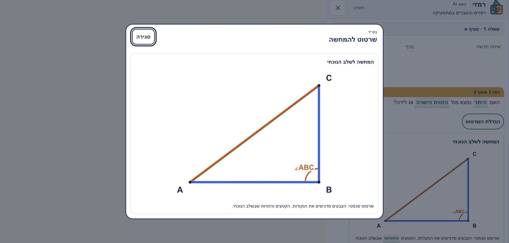
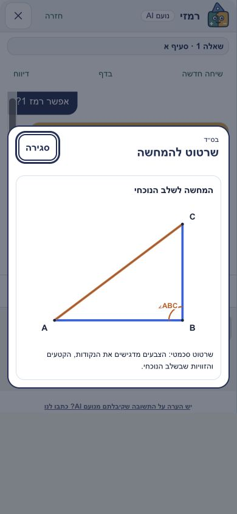

# Ramzi diagram expansion — 2026-10-19

Base: `54fa28047a43cefcd6873637d88a593bbd05d875`. Display-only change; draft for the publication owner. No merge or Wix release performed here.

A live completed 240px SVG was taller than the 114px transcript viewport at 1420×678. Each generated/verified geometry figure now offers **הגדלת השרטוט**. It opens a modal clone of the rendered result; native Escape/close removes the clone and returns focus. Tab/Shift+Tab stay on close and the scrollable diagram region. Cloned glossary buttons become plain text rather than dead controls. If the chat cannot contain the figure, completion reveals the expansion button.

No geometry, solver answers, Google, origin checks, rate limiting, persistence or provider configuration changed. Existing original-question expansion is preserved. Both viewer variants were patched independently, not synchronized.

## Browser evidence

Real Brave, static fixture with the two SVGs already produced by the live Pythagoras conversation. Production CSS and expansion helper are extracted from the changed viewer; no further model requests. This is UI replay, not a new live model end-to-end test.

- **1420×678:** dialog bounds x350..1070, y66.42..611.57; SVG height372.90, fully visible. Enter opens; Escape removes dialog; focus returns to the initiating button.
- **390×844:** dialog x12..378, y206.13..637.88; SVG312×240, fully visible without horizontal overflow. Close returns focus; keyboard cycling verified.
- **390×360:** content264px, scrollHeight360px; End scrolls to96px while header remains at14px. Closing remains accessible.
- Existing live hint and normal/retry model diagrams were independently verified before this UI change: [live receipt](https://github.com/noamd-collab/noam-agent-hub/issues/2#issuecomment-6265080820).




Reproduce without paid calls (from repository root):

```sh
mkdir -p /tmp/ramzi-expansion-preview
node docs/qa/ramzi-diagram-expand-20261019/preview.mjs /tmp/ramzi-expansion-preview/index.html
python3 -m http.server 8769 --bind 127.0.0.1 --directory /tmp/ramzi-expansion-preview
```

The static fixture intentionally has no working chat/model/PDF controls; exercise only the new expansion button and dialog. It is not shipped as a site route.

## Validation

- 108 geometry/compiler regression tests passed.
- 30 viewer/expansion tests passed. The existing diagram-viewer fixture lacked its markdown formatting helper; a test-only stub was added. The short-scrollport expectation now checks the expansion button instead of a clipped SVG.
- 22 protected-design tests passed. Only the explicitly changed viewer head/script fences were updated; other protected files remain fixed.
- Wix production build succeeded using `.env.local` only.
- [Wix preview](https://eg7sqp-noam-math-astro-poc-amiramnoam-130a.wix-site-host.com/worksheet-viewer-noam.html?g=8&x=G8-T49&lv=a&pdf=26fd1a0a92204cfb95855ff28bf0dfeb&pilot=1) loaded the worksheet and section controls in Brave. No fresh model request was made in preview.
- DeepSeek/Qwen independent reviews are still pending; no review credentials were available in this shell, and a draft is not approval to publish.
